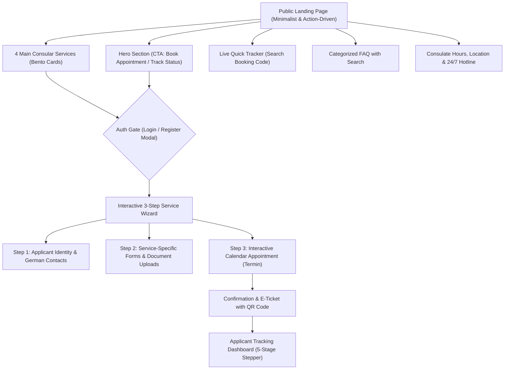

# Blueprint & Flow Architecture: KJRI Frankfurt Community & Passport Portal

Dokumen ini merupakan hasil perumusan alur (*drafting flow*) dan spesifikasi teknis untuk portal layanan konsuler & paspor **KJRI Frankfurt (Konsulat Jenderal Republik Indonesia di Frankfurt am Main)**, yang dirancang untuk kebutuhan demo presales berstandar tinggi.

---

## 1. Ringkasan Parameter Proyek

| Parameter | Spesifikasi |
| :--- | :--- |
| **Target Pengguna** | Warga Negara Indonesia (WNI) & Pemohon Paspor di wilayah kerja KJRI Frankfurt (Hessen, Baden-Württemberg, Bayern, Nordrhein-Westfalen, Rheinland-Pfalz, Saarland) |
| **Gaya Visual (UI/UX)** | Mengacu pada [Sunny Consent Landing](https://sunny-consent-landing.vercel.app/) (*Plus Jakarta Sans*, Deep Navy `#0B2545`, Warm Amber `#F59E0B`, rounded cards, clean pill badges, micro-interactions) |
| **Tema Tampilan** | Single modern clean theme (fokus institusional diplomatik modern, tanpa toggle dark mode) |
| **Bahasa Portal** | **Dual Bahasa**: Default / Utama: **English (EN)**, dengan opsi alih bahasa instan ke **Bahasa Indonesia (ID)** |
| **Tingkat Interaktivitas** | **End-to-End Interactive Web App**: Berjalan responsif dengan state interaktif (ganti bahasa, formulir 3-step, validasi berkas, kalender slot janji temu, generate e-ticket QR, dan tracking live) |

---

## 2. Arsitektur Informasi & Sitemap



---

## 3. Detail Halaman & Alur Pengguna (User Flow)

### 3.1. Halaman Awal (Landing Page Publik)
* **Top Announcement Ribbon:** Info penting konsuler (misal: jam operasional loket paspor & pengingat lapor diri *Peduli WNI*).
* **Navigation Bar:**
  * Logo resmi KJRI Frankfurt / Garuda Indonesia.
  * Menu navigasi cepat: *Services*, *Appointment*, *Track Application*, *FAQ*, *Contact*.
  * **Language Switcher (EN | ID)** di pojok kanan atas.
  * Tombol CTA: *Sign In / Register*.
* **Hero Section (Action-Driven):**
  * Headline: *"Consular & Passport Services Portal — Indonesian Consulate General in Frankfurt"*
  * Sub-headline ringkas dan kredibel.
  * **2 Tombol Aksi Utama:**
    1. `Book Passport Appointment` (Mengarahkan langsung ke pemilihan layanan paspor).
    2. `Track Application` (Scroll langsung ke widget pelacakan resi/token).
* **4 Service Cards (Grid Bento):**
  1. **Passport Renewal (Expired / Expiring Soon)** — Penggantian paspor habis masa berlaku (minimal 6 bulan sebelum kedaluwarsa).
  2. **Book Appointment Only (Termin susulan / Reschedule)** — Reservasi slot kedatangan fisik bagi yang telah memiliki kode berkas.
  3. **Damaged Passport Replacement** — Penggantian paspor yang rusak halaman atau fisiknya.
  4. **Lost Passport Replacement (BAP / SPLP)** — Prosedur paspor hilang dengan laporan kepolisian Jerman (*Verlustanzeige*).
* **Live Quick Tracker:**
  * Input: Masukkan *Booking Reference ID* (contoh: `KJRI-FRA-2026-9041`) atau *Passport Number*.
  * Hasil: Modal / Card visual menampilkan tahapan terkini permohonan.
* **Categorized FAQ (Pusat Bantuan):**
  * Search bar pencarian kata kunci cepat.
  * Kategori tabs: *Passport Renewal*, *Peduli WNI (Lapor Diri)*, *Fees & Payment (EUR)*, *Appointment Rules*.
* **Footer & Emergency Section:**
  * Alamat: *Zeppelinallee 23, 60325 Frankfurt am Main*.
  * Jam Buka Loket & Hotline Darurat 24/7 WNI (`+49 162 412 9044`).

---

### 3.2. Gerbang Autentikasi (Sign In / Register)
* Berupa **Clean Modal Dialog** atau halaman minimalis bergaya Sunny.
* **Formulir Ringkas:**
  * Nama Lengkap (sesuai Paspor).
  * Email aktif & Nomor WhatsApp/Telepon aktif di Jerman (format `+49`).
  * Password atau Opsi Quick OTP simulasi.
* State tersimpan di browser sesi pemohon untuk memudahkan pengisian data otomatis (*auto-fill*) pada langkah formulir selanjutnya.

---

### 3.3. Formulir Terpadu 3-Langkah (Simple & User-Friendly Wizard)

Formulir dirancang tetap bersih dan tidak membuat pemohon bingung dengan pembagian 3 langkah progresif:

#### **Step 1: Personal & German Contact Details**
* Full Legal Name (sesuai paspor lama).
* NIK (Nomor Induk Kependudukan - 16 digit) / Nomor Paspor Lama.
* Current German Address (Street, House No, PLZ, City di wilayah yurisdiksi KJRI Frankfurt).
* German Phone / WhatsApp & Email.
* Opsi jenis paspor yang diinginkan: **Electronic Passport (E-Paspor 48 Halaman)** atau **Ordinary Passport (Paspor Biasa 48 Halaman)**.

#### **Step 2: Service-Specific Requirements & Documents**
Field dan zona unggah berkas berubah secara dinamis sesuai layanan yang dipilih:
* **Jika Paspor Habis Masa Berlaku:**
  * Upload Paspor Lama (Halaman Identitas & Catatan).
  * Upload Izin Tinggal Jerman (*Aufenthaltstitel* / Fiktionsbescheinigung / Visa).
  * Upload Bukti Domisili (*Meldebescheinigung*).
  * Konfirmasi Lapor Diri (*Peduli WNI* checkbox & nomor registrasi).
* **Jika Paspor Rusak:**
  * Dokumen standar di atas +
  * Upload Foto bagian paspor yang rusak.
  * Keterangan singkat kronologi kerusakan paspor.
* **Jika Paspor Hilang:**
  * Dokumen identitas di atas +
  * Nomor Laporan Kehilangan Kepolisian Jerman (*Polizeiliche Verlustanzeige*).
  * Upload Berkas Laporan Polisi Jerman (*Verlustanzeige* PDF/JPG).
  * Kronologi singkat kehilangan (untuk kebutuhan Berita Acara Pemeriksaan / BAP).

> *UX Touch:* Dilengkapi drag & drop file uploader interaktif dengan visual thumbnail preview, file size check (< 5 MB), dan status centang hijau instan.

#### **Step 3: Appointment Calendar (Pemilihan Termin) & Slot Waktu**
* **Kalender Hari Kerja Aktif:** Senin s/d Jumat (Sabtu, Minggu & Hari Libur Nasional otomatis disabled).
* **Slot Jam Konsuler (Interval 30 menit):**
  * Sesi Pagi: `09:00 - 09:30`, `09:30 - 10:00`, `10:00 - 10:30`, `10:30 - 11:00`, `11:00 - 11:30`, `11:30 - 12:00`.
  * Sesi Siang: `13:30 - 14:00`, `14:00 - 14:30`, `14:30 - 15:00`, `15:00 - 15:30`.
* Menampilkan indikator kuota tersisa (*"4 slots available"*, *"Fully Booked"*).
* Tombol: `Confirm & Generate E-Ticket`.

---

### 3.4. E-Ticket & Ringkasan Janji Temu
Setelah submit, pemohon langsung mendapatkan E-Ticket resmi yang elegan:
* **QR Code Unik** untuk scan kehadiran di gerbang loket konsuler KJRI Frankfurt.
* **Kode Booking Unik** (misal: `FRA-2026-8812`).
* Tanggal, Jam, dan Lokasi Kedatangan (*Consular Service Hall, Zeppelinallee 23, Frankfurt*).
* **Checklist Dokumen Fisik yang Wajib Dibawa saat Kedatangan:**
  * Paspor lama asli.
  * Kartu Izin Tinggal asli (*Aufenthaltstitel*).
  * *Meldebescheinigung* asli/terbaru.
  * Surat lapor polisi asli (jika kasus paspor hilang).
  * Bukti biaya PNBP (metode pembayaran kartu debit / *EC-Karte*).
* Tombol aksi: `Download E-Ticket (PDF)`, `Add to Calendar (.ics)`, dan `Go to Application Dashboard`.

---

### 3.5. Pemantauan Status Permohonan (Tracking Stepper)
Sistem pelacakan visual dengan 5 tahapan transparan:

```
[1. Application Submitted] ──> [2. Document Verified] ──> [3. Biometric & Photo Termin] ──> [4. Passport Printing] ──> [5. Ready for Pickup / Dispatched]
```

* **Detail Status:**
  * Timestamp tiap perubahan status.
  * Catatan petugas konsuler (misal: *"Dokumen telah diverifikasi lengkap. Harap hadir 10 menit sebelum jadwal termin"*).
  * Opsi pengiriman paspor kembali melalui surat tercatat (*Einschreiben DHL/Deutsche Post*) jika pemohon menyerahkan amplop beralamat dan berprangko saat hari H.

---

## 4. Rincian Teknis & Rencana Pembangunan Prototipe

* **Struktur Kode & Folder:**
  * Proyek web berlokasi langsung di `Sunny Page - Kemenlu KJRI`.
  * Menggunakan Tailwind CSS dengan konfigurasi warna `sunny-navy`, `sunny-gold`, `sunny-slate`.
  * Multi-language dictionary `i18n` sederhana (English & Bahasa Indonesia).
  * Local/State persistence sehingga alur pengisian form, appointment booking, dan tracking dapat didemokan secara nyata (*end-to-end*).
